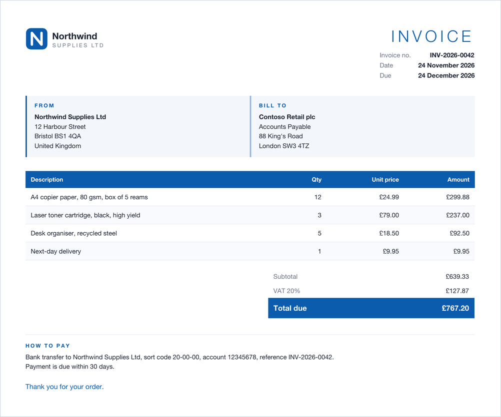

# Marqius.Wkhtmltopdf: wkhtmltopdf for .NET, maintained

[](https://www.nuget.org/packages/Marqius.Wkhtmltopdf)
[](https://www.nuget.org/packages/Marqius.Wkhtmltopdf)
[](https://www.nuget.org/packages/Marqius.Wkhtmltopdf)
[](https://github.com/marqiushq/marqius-wkhtmltopdf-dotnet/actions)

**Marqius.Wkhtmltopdf puts wkhtmltopdf in your .NET app, from one NuGet package.** It contains marqius-wkhtmltopdf, the maintained replacement for wkhtmltopdf, for Windows, Linux and macOS. It reads the same command line and options as wkhtmltopdf 0.12.6, so Rotativa and other libraries that run wkhtmltopdf work as before. There is no Qt, no X server and nothing else to install.



*This invoice is made from HTML and CSS by marqius-wkhtmltopdf, the program in this package: [see its code](https://github.com/marqiushq/marqius-wkhtmltopdf-dotnet/tree/main/samples/invoice).*

- **One package for every server:** Windows x64, Linux x64 and ARM64 (Alpine too), macOS on Apple silicon. `dotnet publish -r linux-x64` keeps only the program that system needs.
- **Checked before it runs:** each program is GitHub's own build, checked against its SHA-256 and GitHub build record before it goes into the package, and against that SHA-256 again before it first runs.
- **Many languages:** English, Arabic, Hebrew, Hindi, Thai, Chinese, Japanese, Korean and more.

New to .NET or to PDFs? [The manual](https://github.com/marqiushq/marqius-wkhtmltopdf-dotnet/blob/main/docs/manual.md) takes you step by step.

Using DinkToPdf? Use [Marqius.DinkToPdf](https://www.nuget.org/packages/Marqius.DinkToPdf) instead: DinkToPdf's own code, with no `libwkhtmltox`.

## Make your first PDF

**Step 1.** Make a new app and add the package:

```bash
dotnet new console -o Invoice
cd Invoice
dotnet add package Marqius.Wkhtmltopdf
```

**Step 2.** Open `Program.cs`, delete everything in it, and paste this:

<!-- example: quickstart Program.cs -->
```csharp
using System.Diagnostics;
using Marqius.Wkhtmltopdf;

// The HTML to turn into a PDF
File.WriteAllText("invoice.html", "<h1>Invoice 42</h1><p>Thank you for your order.</p>");

// Run the program, as you would run wkhtmltopdf: input file, output file
var run = Process.Start(Wkhtmltopdf.StartInfo(new[] { "invoice.html", "invoice.pdf" }))!;
string messages = run.StandardError.ReadToEnd(); // read before waiting, so a long run cannot fill the pipe
run.WaitForExit();

Console.WriteLine(run.ExitCode == 0 ? "invoice.pdf is ready" : messages);
```

**Step 3.** Run it:

```bash
dotnet run
```

You see `invoice.pdf is ready`, and `invoice.pdf` is in the folder. Every wkhtmltopdf option works in that list, such as `"--orientation", "Landscape"`.

`Wkhtmltopdf.Path` is the program's full path, for any library that asks where wkhtmltopdf is.

## Use it with Rotativa (ASP.NET Core MVC)

Rotativa runs `wkhtmltopdf` from a folder of its own, `wwwroot/Rotativa`. One line puts it there, using this package's program.

**Step 1.** Make a new MVC website and add both packages:

```bash
dotnet new mvc -o Shop
cd Shop
dotnet add package Rotativa.AspNetCore
dotnet add package Marqius.Wkhtmltopdf
```

**Step 2.** Open `Program.cs`, delete everything in it, and paste this:

<!-- example: rotativa Program.cs -->
```csharp
using Marqius.Wkhtmltopdf;
using Rotativa.AspNetCore;

var builder = WebApplication.CreateBuilder(args);
builder.Services.AddControllersWithViews();

var app = builder.Build();

// Put wkhtmltopdf where Rotativa looks for it, then tell Rotativa where that is
Wkhtmltopdf.Install(Path.Combine(app.Environment.WebRootPath, "Rotativa"));
RotativaConfiguration.Setup(app.Environment.WebRootPath, "Rotativa");

app.UseStaticFiles();
app.UseRouting();
app.MapControllerRoute(name: "default", pattern: "{controller=Home}/{action=Index}/{id?}");
app.Run();
```

**Step 3.** Open `Controllers/HomeController.cs`, delete everything in it, and paste this:

<!-- example: rotativa HomeController.cs -->
```csharp
using Microsoft.AspNetCore.Mvc;
using Rotativa.AspNetCore;

namespace Shop.Controllers;

public class HomeController : Controller
{
    public IActionResult Index() => View();

    // The home page, as a PDF
    public IActionResult Invoice() => new ViewAsPdf("Index");
}
```

**Step 4.** Run it:

```bash
dotnet run
```

It prints an address such as `http://localhost:5000`. Open that address with `/Home/Invoice` at the end, and you see the home page as a PDF.

Already have an old `wkhtmltopdf.exe` in `wwwroot/Rotativa`? You can delete it. If you leave it, `Install` keeps it next to the new one, renamed `wkhtmltopdf.before-marqius`.

## Licence and trial

marqius-wkhtmltopdf is commercial software with a 30-day free trial.
- **After the trial,** without a licence, each page gets one small line: "Prepared by Marqius, Purchase Licence". Your PDFs never stop.
- **Personal, teaching and open-source use** is free with a Community licence.
- **To use a licence,** set the environment variable `MARQIUS_LICENCE` to the licence, or to the path of a file that holds it.

[See the plans and prices](https://marqius.com/licence/marqius-wkhtmltopdf).

This package's own .NET code is MIT; see LICENSE.md.
